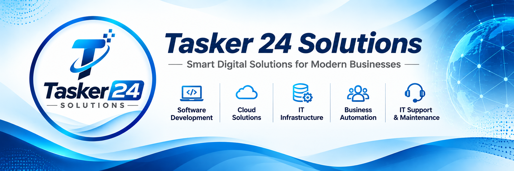

  

<h1 align="center">Tasker 24 Solutions</h1>

  <strong>Smart Digital Solutions for Modern Businesses</strong> 
  AI-powered software, business automation, and IT services. 
  Based in Dhaka, Bangladesh.

  <a href="https://www.tasker24solutions.com">Visit our website</a>
  &nbsp; • &nbsp;
  <a href="mailto:tasker24solutions@gmail.com">Discuss a project</a>
  &nbsp; • &nbsp;
  <a href="https://github.com/t24solutions?tab=repositories">Explore our repositories</a>

---

## Technology that supports your business

**Tasker 24 Solutions** is a software and IT products and services company based in Dhaka, Bangladesh. We help businesses turn ideas into practical digital solutions through software development, AI-powered tools, automation, and IT services.

Our focus is simple: make technology useful, simplify everyday work, and support the way your business grows.

## What we do

| Service | How we help |
| :--- | :--- |
| **Software Development** | Custom applications and digital products built around business needs. |
| **AI & Business Automation** | AI-powered solutions and workflows that simplify repetitive tasks and business processes. |
| **Cloud Solutions** | Cloud setup, application deployment, and management of cloud environments. |
| **IT Infrastructure** | Setup and integration of the technology that supports daily operations. |
| **IT Support & Maintenance** | Troubleshooting, updates, and ongoing care for software and IT systems. |

## How we approach our work

- **Understand the need.** Start with the business problem and the people using the solution.
- **Build with purpose.** Keep the experience clear and the implementation maintainable.
- **Use AI thoughtfully.** Apply intelligent tools where they add practical value.
- **Support what comes next.** Consider maintenance and evolving requirements from the start.

## Explore our work on GitHub

This profile is the home of our public development work. Browse our repositories for available projects, documentation, and resources.

**[View public repositories →](https://github.com/t24solutions?tab=repositories)**

For questions about a public project, use its Issues or Discussions when available. For project inquiries and business conversations, contact us directly by email.

## Let's build something useful

Have an idea, a workflow to improve, or an IT challenge to solve? Tell us what you are working on and what you want to achieve.

| | Contact |
| :--- | :--- |
| **Website** | [www.tasker24solutions.com](https://www.tasker24solutions.com) |
| **Email** | [tasker24solutions@gmail.com](mailto:tasker24solutions@gmail.com) |
| **GitHub** | [@t24solutions](https://github.com/t24solutions) |
| **Location** | Dhaka, Bangladesh |

---

  <strong>Tasker 24 Solutions</strong> 
  Software • AI & Automation • Cloud • IT Infrastructure • Support

